# The images

What `make bench` renders, side by side: this project against the two Lean
programs it was ported from. Render times are in [`RESULTS.md`](RESULTS.md),
which is where they belong -- they move a few percent between runs, while
everything below is deterministic. How to reproduce: [`README.md`](README.md).

| | Rocq (Wasm) | Lean, 1 core | Lean, N cores | difference, x4 |
|---|---|---|---|---|
| **`first-light`** 512x256 1 spp, depth 1 mean diff 0.55, max 1 |  | 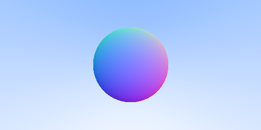 | -- | 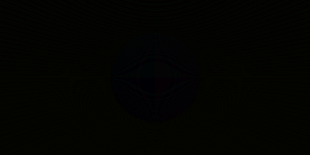 |
| **`spheres-preview`** 320x213 16 spp, depth 30 mean diff 3.17, max 95 | 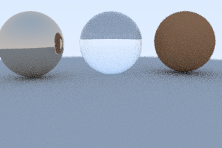 | 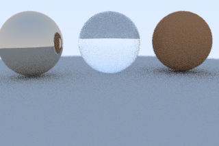 | 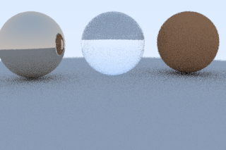 | 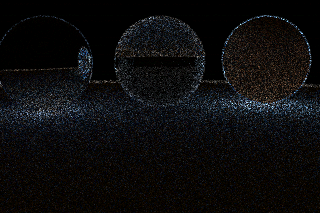 |
| **`spheres-quality`** 200x133 64 spp, depth 50 mean diff 1.67, max 40 | 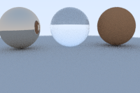 |  |  | 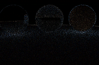 |
| **`weekend-small`** 100x66 4 spp, depth 30 mean diff 31.92, max 223 | 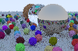 | 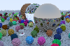 |  | 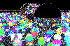 |

All four are scaled to the same width here; the real sizes are in the first
column. The last column is the per-channel distance between the two images
multiplied by four, so black is agreement.

`first-light` has no N-core entry: that renderer (TOTBWF/lean4-raytrace) has
no threading to turn on. It is also the only row where the two render the same
thing deterministically -- one ray per pixel, no sampling -- and there **no
channel anywhere is off by more than one level in 255**, which is the check on
Q38.24 fixed point. The two `spheres-` rows are the same four spheres along
different random sequences: the same picture, different noise, which more
samples drives down (3.17 at 16 samples, 1.67 at 64). `weekend-small` is not
even the same world -- its 488 spheres are *drawn* from the generator, so the
two implementations place and colour them differently, and its difference
column says nothing about the arithmetic.

On AMD Ryzen 5 PRO 7540U w/ Radeon 740M Graphics, 2026-10-15.
